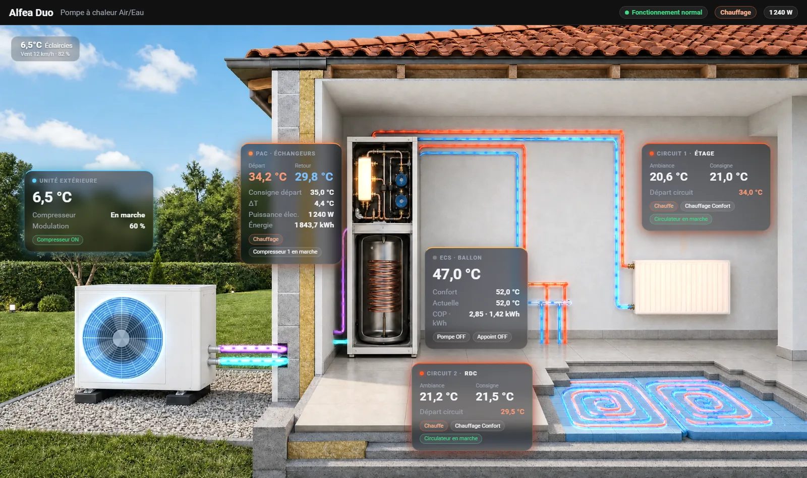

# Atlantic Alféa BSB-LAN pour Home Assistant

Intégration Home Assistant pour **piloter, mesurer et comprendre** une pompe à
chaleur **Atlantic Alféa Extensa Duo** à travers une passerelle
[BSB-LAN](https://docs.bsb-lan.de/fr/index.html).



> **2.0.0** : nouvelle carte synoptique photoréaliste (jour, nuit, météo), écriture des
> programmes horaires depuis Home Assistant, noms des circuits dans les options.
> L'ancienne carte `pac-synoptique-card` est supprimée : voir
> [Mise à jour depuis la 1.5.x](#mise-à-jour-depuis-la-15x).

## Objectif

Ce dépôt est un fork de
[Jrmysmallstep/home-assistant-atlantic-alfea-bsb-lan](https://github.com/Jrmysmallstep/home-assistant-atlantic-alfea-bsb-lan)
avec un objectif plus large :

- **Contrôle complet** depuis Home Assistant : mode de la PAC, marche/arrêt et
  régime de chaque circuit, consignes Confort/Éco chauffage et
  rafraîchissement, dérogations natives, ECS.
- **Suivi de la consommation** : énergie électrique répartie entre l'ECS et les
  circuits C1+C2 à partir d'un compteur précis, COP de chaque charge ECS.
- **Observation du fonctionnement** : loi d'eau, températures départ/retour,
  états du régulateur, circulateurs, compresseur, défauts, programmes horaires.

La programmation horaire reste dans la PAC, qui reste la référence pour les
régimes Confort/Réduit : l'intégration importe les programmes natifs et permet
de les modifier, mais ne les remplace pas par des automatisations.

## Matériel validé

Atlantic Alféa Extensa Duo, régulateur **RVS21.831F** (famille 211,
variante 127), BSB-LAN 5.x sur ESP32. D'autres variantes Siemens RVS peuvent
fonctionner mais ne sont pas validées.

## Prérequis

- Home Assistant avec **MQTT** opérationnel.
- Une passerelle **BSB-LAN** qui publie ses paramètres sur MQTT (découverte
  automatique Home Assistant active).
- L'**adresse HTTP de BSB-LAN** (ex. `http://192.168.1.88`) à renseigner dans les
  options de l'intégration : elle active les lectures JSON, les régimes
  Auto/Éco/Confort, l'historique des défauts et l'import des programmes.

## Installation

### HACS (dépôt personnalisé)

1. HACS → **⋮** → **Custom repositories** → ajouter
   `https://github.com/fastm3/home-assistant-atlantic-alfea-bsb-lan`, type
   **Integration**.
2. Installer **Atlantic Alfea BSB-LAN**, puis **redémarrer Home Assistant**.
3. **Paramètres → Appareils et services → Ajouter une intégration** →
   *Atlantic Alfea BSB-LAN*. La détection associe automatiquement les entités
   BSB-LAN ; les paramètres ambigus sont demandés.
4. Dans les **options** de l'intégration, renseigner l'adresse BSB-LAN, le
   **compteur d'énergie global** de la PAC (capteur `kWh` de la ligne PAC) et
   les **noms des circuits** (voir [Options](#options-de-lintégration)).

Si l'intégration d'origine est installée par HACS, retirez d'abord son dépôt
personnalisé : sinon HACS proposera ses mises à jour à la place de celles-ci.

### Manuelle

Copier `custom_components/atlantic_alfea_controller/` dans le dossier
`custom_components` de Home Assistant, redémarrer, puis ajouter l'intégration.

### Cartes Lovelace

Les deux cartes sont servies par l'intégration. Ajouter une fois chaque
ressource (**Paramètres → Tableaux de bord → Ressources**, type *Module
JavaScript*) :

```text
/alfea-synoptique/pac-synoptique-photo-card.js?v=<version>
/alfea-synoptique/pac-programmes-card.js?v=<version>
```

Changer `?v=` à chaque mise à jour pour forcer le rechargement par les
navigateurs. Détails : [docs/CARTE_SYNOPTIQUE.md](docs/CARTE_SYNOPTIQUE.md).

### Mise à jour depuis la 1.5.x

La 2.0.0 est une version majeure :

- la carte `custom:pac-synoptique-card` est **supprimée**. Supprimer sa
  ressource `/alfea-synoptique/pac-synoptique-card.js`, ajouter celle de la
  carte photo et remplacer les cartes concernées par
  `custom:pac-synoptique-photo-card`. Ses panneaux (alarmes, diagnostics,
  graphes, loi d'eau, commandes) sont repris en onglets sous l'image ;
- les capteurs de programme natif portent désormais le **nom configuré du
  circuit** (C1 = programme 501, C2 = 521) au lieu de « RDC » / « étage » fixes ;
  leurs `entity_id` existants ne changent pas.

Correspondance des options : [docs/CARTE_SYNOPTIQUE.md](docs/CARTE_SYNOPTIQUE.md#depuis-la-15x).

## Options de l'intégration

**Paramètres → Appareils et services → Atlantic Alfea BSB-LAN → Configurer.**

| Option | Rôle |
|---|---|
| **Nom du circuit 1 / 2** | Noms affichés des circuits (C1 = paramètres 7xx / programme 501, C2 = 10xx / 521). Exposés dans l'attribut `nom_circuit` des thermostats et des capteurs de programme, et repris par les cartes. Défaut : « Circuit 1 » / « Circuit 2 ». |
| **Adresse BSB-LAN** | URL HTTP de BSB-LAN (`http://192.168.x.x`). Active les lectures JSON (`/JQ`), les régimes Auto/Éco/Confort, l'historique des défauts, l'import et l'écriture des programmes horaires. |
| **Compteur d'énergie global** | Compteur électrique précis de la ligne PAC : répartition de l'énergie entre l'ECS et C1+C2, COP des charges ECS ; repris par la carte photo. Vide = capteurs d'énergie désactivés. |
| **Q3 = vanne 3 voies ECS confirmée** | À cocher si la sortie Q3 pilote la vanne de dérivation ECS (BSB 5731 = 2) : la position de la vanne est alors déduite de 8820. |
| **Cycle court — seuil de secours** | Durée de marche du compresseur en dessous de laquelle un cycle est court ; le temps de marche minimum de la PAC (2842) est prioritaire. |
| **Démarrages fréquents — seuil par heure** | Alarme au-delà de ce nombre de démarrages sur une heure glissante. |
| **Écart départ / consigne — seuil et temporisation** | Écart toléré entre le départ mesuré (8412) et la consigne de départ (8411), et durée pendant laquelle il doit persister avant l'alarme ; surveillé compresseur en marche, hors dégivrage et hors charge ECS. À allonger (20–30 min) avec un plancher chauffant à forte inertie. |

Chaque option est expliquée dans le formulaire.

## Configuration de BSB-LAN

BSB-LAN publie sur MQTT jusqu'à 40 paramètres avec un intervalle commun.
L'intégration lit cette configuration (`/JI`, lecture seule) et n'interroge
elle-même que ce qui n'est pas déjà publié assez souvent : aucun paramètre
n'est lu deux fois sur le bus.

Réglage recommandé (*Settings → Logging*) : **MQTT**, **60 s**, et ces
25 paramètres :

```text
700,901,1000,1201,1600,8000,8001,8003,8006,8400,8410,8412,8413,8700,
8740,8741,8743,8760,8770,8771,8773,8820,8821,8830,9031
```

Le capteur **BSB-LAN - Journalisation** indique ce qui est couvert, ce que
l'intégration lit en plus et ce qui manque. Explications et charge du bus :
[docs/BSB_LAN_JOURNALISATION.md](docs/BSB_LAN_JOURNALISATION.md).

## Pilotage

Toutes les commandes passent par des entités Home Assistant et sont
**confirmées par relecture BSB-LAN** ; une commande non confirmée est signalée
comme erreur.

| Fonction | Entité | Paramètres BSB |
|---|---|---|
| Mode de la PAC : Off / Chauffage / Refroidissement | `select` *Mode global* | 700, 901, 1000, 1201 |
| Circuit Off / Auto (saison du mode global) | `climate` *C1 - Circuit 1*, *C2 - Circuit 2* | 700/901, 1000/1201 |
| Régime Auto / Éco / Confort du circuit | préréglage du `climate` (adresse BSB-LAN requise) | 700, 1000 |
| Consignes Confort / Éco, chauffage et rafraîchissement | 8 entités `number` | 710, 712, 902, 903, 1010, 1012, 1202, 1203 |
| Dérogation temporaire native | consigne du `climate` + durée `number` + bouton *Annuler dérogation* | 701/1001, 10990–10993 |
| ECS : mode et consignes | `water_heater` *Eau chaude sanitaire* | 1600, 1610, 1612 |
| Forçage d'un cycle ECS | bouton *Forçage cycle ECS* | — |
| Horloge de la PAC | bouton *Horloge PAC - Synchroniser* | 0 |
| Programmes horaires chauffage C1/C2 et ECS | service `set_weekly_program`, mode édition de la carte Programmes | 501–507, 521–527, 561–567 |

Garde-fous :

- le mode global coupe d'abord la saison opposée, puis active la saison
  demandée ; un circuit ne peut pas passer dans la saison opposée à celle du
  mode global ;
- un circuit à l'arrêt ne reçoit aucune commande de régime ;
- la confirmation BSB-LAN attend jusqu'à 30 s et redemande la valeur si le
  retour MQTT tarde ;
- dérogation : écart de 0,1 à 5 °C par rapport à la consigne effective ; en
  rafraîchissement, seulement vers plus froid. La durée est gérée par le
  régulateur, qui revient seul au programme.

## Programmes horaires

Les programmes natifs (chauffage C1/C2, ECS, rafraîchissement C1/C2) sont
importés par JSON (`/JQ`, sans consommer d'emplacement du journal MQTT) une
minute après le démarrage de Home Assistant, puis chaque jour à 04:00 et à la
demande (bouton *Programmes natifs - Actualiser*). Un échec est seulement
journalisé.

Le service `atlantic_alfea_controller.set_weekly_program` écrit un programme
jour par jour (`/JS`) :

| Champ | Description |
|---|---|
| `program` | `chauffage_c1` (501–507), `chauffage_c2` (521–527) ou `ecs` (561–567). Le rafraîchissement reste en lecture seule. |
| `days` | liste de jours : `lundi` … `dimanche` |
| `slots` | 0 à 3 plages `{debut, fin}` au format `HH:MM`, pas de 10 min, `24:00` accepté en fin ; liste vide = aucune plage Confort |
| `config_entry_id` | facultatif s'il n'y a qu'une PAC |

Sécurités : validation complète avant tout envoi (format, pas, ordre,
chevauchement, 3 plages) ; aucun envoi si le jour est inchangé ; accusé
BSB-LAN ; **relecture de chaque jour** et, si elle diffère, **restauration
automatique** de la valeur d'origine puis arrêt. Réponse :
`{"program": "ecs", "results": {"dimanche": "écrit et vérifié"}}`.

```yaml
action: atlantic_alfea_controller.set_weekly_program
data:
  program: chauffage_c2
  days: [lundi, mardi, mercredi, jeudi, vendredi]
  slots:
    - debut: "06:00"
      fin: "08:30"
    - debut: "17:00"
      fin: "22:00"
```

Format envoyé à BSB-LAN : `06:00-08:30_17:00-22:00_xx:xx-xx:xx` (validé sur
RVS21.831F).

## Énergie

| Capteur | Contenu |
|---|---|
| *ECS - Énergie consommée* | énergie électrique consommée pendant les charges ECS |
| *C1+C2 - Énergie consommée* | énergie électrique consommée hors charge ECS |
| *ECS - COP session* | COP de la dernière charge ECS (historique des 4 dernières en attributs) |
| *PAC - Énergie totale* | index 3113 de la PAC (arrondi au kWh) |

Les deux capteurs d'énergie se partagent chaque incrément du **compteur
électrique global** choisi dans les options (compteur précis de la ligne PAC) : à l'ECS pendant une
charge ECS (état 8003), aux circuits sinon. Ils sont `total_increasing` et
utilisables dans le tableau de bord Énergie. Les compteurs internes de la PAC
3124/3125/3126, arrondis au kWh, ne sont pas utilisés.

## Observation

- **Carte PAC Synoptique photo** : vue en coupe photoréaliste de
  l'installation, animée d'après l'état réel (compresseur et hélice selon la
  modulation, liaisons frigorifiques, circuits, radiateur, plancher, charge ECS
  et appoint électrique) ; décor jour/nuit et météo (neige, pluie, brouillard,
  vent) ; panneaux de valeurs ; onglets alarmes, diagnostics, graphes de
  consommation, loi d'eau et commandes.
- **Carte Programmes PAC** : programmes horaires natifs chauffage, ECS et
  rafraîchissement, avec **mode édition** (glisser les plages, copier/coller,
  modèles, récapitulatif avant écriture) pour le chauffage et l'ECS.
- **Diagnostics** : cycles courts, démarrages fréquents, écart départ/consigne,
  horloge désynchronisée, historique des 10 derniers défauts, état de
  l'installation, journalisation BSB-LAN.

## Entités principales

| Domaine | Entités |
|---|---|
| `climate` | C1 - Circuit 1, C2 - Circuit 2 |
| `water_heater` | Eau chaude sanitaire |
| `select` | Mode global |
| `number` | consignes Confort/Éco chauffage et rafraîchissement C1/C2, durées de dérogation |
| `button` | Annuler dérogation C1/C2, Forçage cycle ECS, Horloge PAC - Synchroniser, Programmes natifs - Actualiser |
| `binary_sensor` | circulateurs C1/C2, dérogations C1/C2, alarme horloge |
| `sensor` | états PAC/circuits/ECS, températures, énergie, COP ECS, programmes natifs, historique des défauts, horloge, journalisation BSB-LAN, état de l'installation |

## Lectures et fréquences

Chaque paramètre a une période cible : 1 min (états, modes, températures),
5 min (diagnostics), 15 min (consignes, compteurs), 1 h (constantes). Un
paramètre déjà publié assez souvent par le journal MQTT de BSB-LAN n'est pas
relu ; les autres sont demandés par `BSB-LAN/poll` ou, pour 8740/8770/8830/8821,
par une requête JSON par minute. Après une écriture depuis Home Assistant, le
paramètre est relu immédiatement. Toutes les requêtes HTTP vers BSB-LAN passent
par une file unique : jamais deux à la fois. Ce sont uniquement des lectures,
sauf les commandes listées dans *Pilotage* (dont l'écriture des programmes).

## Limites connues

- La position des vannes 3/4 voies n'est pas disponible : BSB-LAN n'expose que
  les commandes d'ouverture/fermeture des vannes mélangeuses.
- Pas de compteur d'énergie séparé C1 / C2 : seulement C1+C2.
- Sans compteur d'énergie global dans les options, les capteurs ECS / C1+C2 et
  le COP ECS restent indisponibles.
- Une consigne modifiée sur le panneau de la PAC apparaît dans Home Assistant
  après au plus 15 min (sauf si elle est journalisée par BSB-LAN).
- Les paramètres disponibles dépendent du régulateur et de son firmware ; un
  paramètre absent (`---`) est ignoré.

## Plus d'informations

- [CHANGELOG.md](CHANGELOG.md) : historique des versions.
- [docs/BSB_LAN_JOURNALISATION.md](docs/BSB_LAN_JOURNALISATION.md) : réglage de
  BSB-LAN et lectures de l'intégration.
- [docs/CARTE_SYNOPTIQUE.md](docs/CARTE_SYNOPTIQUE.md) : options des cartes.
- [tools/synoptique_photo/](tools/synoptique_photo/README.md) : comment les images de la carte photo sont produites.
- [Documentation BSB-LAN](https://docs.bsb-lan.de/fr/index.html).

Projet communautaire non officiel, sans lien avec Atlantic ni avec le projet
BSB-LAN.
