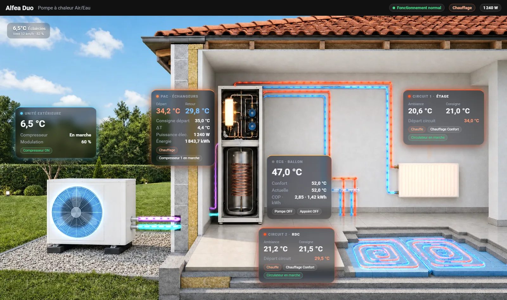
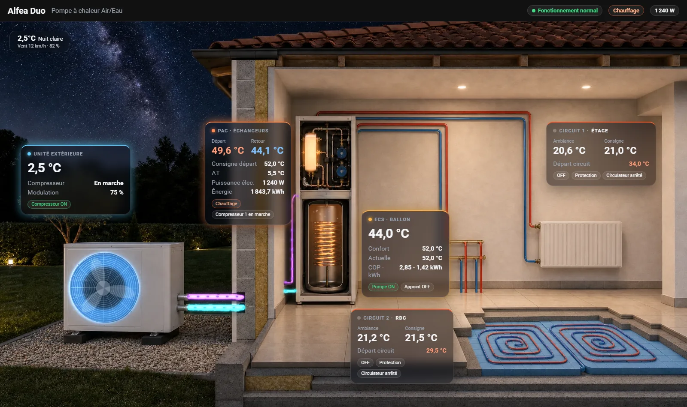
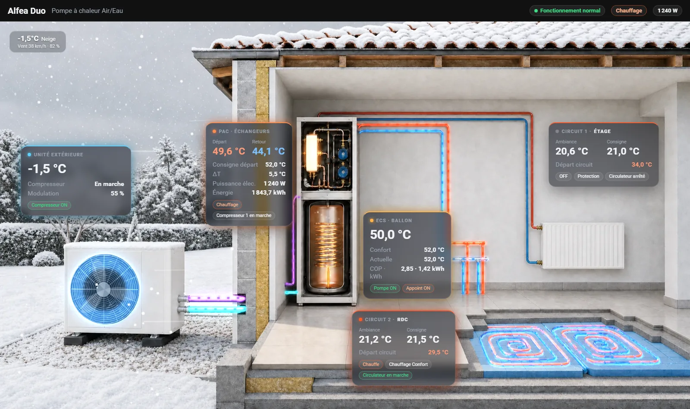
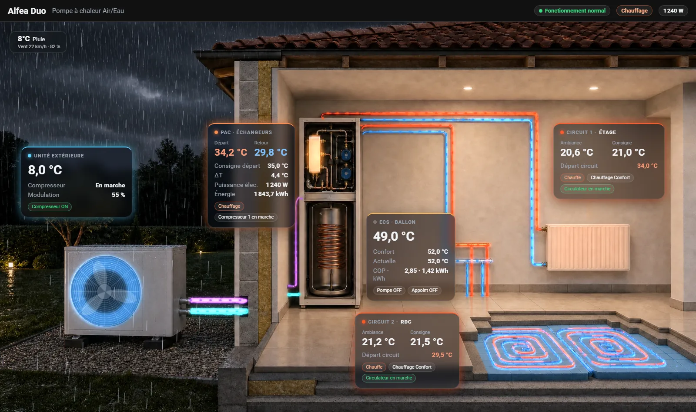
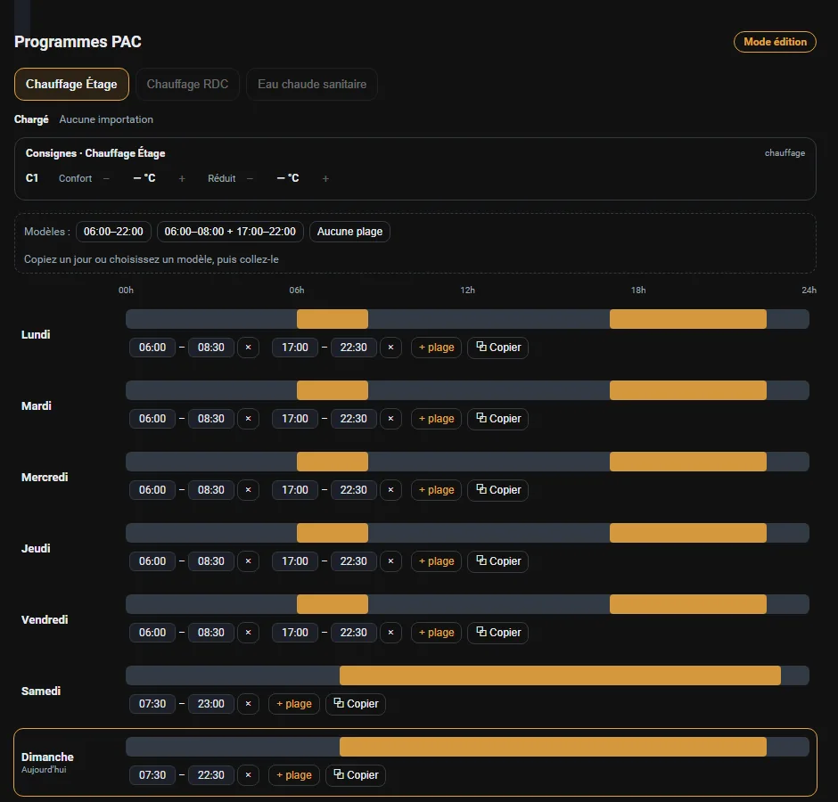

# Cartes Lovelace

Les cartes sont livrées avec l'intégration (`custom_components/atlantic_alfea_controller/www/`)
et servies par Home Assistant sous `/alfea-synoptique/`.

## Installation

1. Redémarrer Home Assistant après l'installation ou la mise à jour.
2. **Paramètres → Tableaux de bord → Ressources** → ajouter une fois, type
   *Module JavaScript* :
   - `/alfea-synoptique/pac-synoptique-photo-card.js?v=<version>`
   - `/alfea-synoptique/pac-programmes-card.js?v=<version>`
3. À chaque mise à jour, changer la valeur `?v=` puis recharger la page
   (`Ctrl+Maj+R`).

### Depuis la 1.5.x

La carte `custom:pac-synoptique-card` est **supprimée** en 2.0.0. Ses panneaux
(alarmes, diagnostics, graphes, loi d'eau, commandes) sont repris dans la carte
photo.

1. Supprimer la ressource `/alfea-synoptique/pac-synoptique-card.js` (et toute
   ancienne copie `/local/pac-synoptique-card.js`).
2. Ajouter la ressource de la carte photo (ci-dessus).
3. Remplacer chaque carte `custom:pac-synoptique-card` par
   `custom:pac-synoptique-photo-card` (voir la correspondance des options plus bas).
4. Renseigner les noms des circuits dans les **options de l'intégration** : ils
   sont repris par les deux cartes.

## PAC Synoptique photo (`custom:pac-synoptique-photo-card`)



Vue photoréaliste en coupe de l'installation Alféa Extensa Duo : groupe
extérieur et liaisons frigorifiques, module intérieur avec ballon ECS 180 L et
appoint électrique, circuit 1 sur radiateur, circuit 2 sur plancher chauffant.
Des panneaux en surimpression donnent les valeurs près de chaque élément ; un
clic ouvre la fiche de l'entité.

Ce qui s'anime, toujours d'après l'état réel des entités :

| Élément | Déclencheur | Effet |
|---|---|---|
| Groupe extérieur | compresseur en marche / dégivrage | lueur, hélice dont la vitesse suit la modulation, filets d'air |
| Liaisons frigorifiques | compresseur | lueur et flux animés |
| Module hydraulique | compresseur | lueur de l'échangeur |
| Circuit 1 (radiateur) | circulateur C1 | flux dans les tuyaux, chaleur et air chaud au-dessus du radiateur |
| Circuit 2 (plancher) | circulateur C2 | flux, collecteur et boucles du plancher |
| Ballon ECS | charge ECS (pompe ou V3V) | serpentin, eau qui chauffe (teinte selon la température du ballon), convection |
| Appoint électrique | appoint ECS | foyer rouge et bulles autour de la résistance |

Les flux accélèrent avec la modulation du compresseur. Aucune valeur n'est
inventée : une entité absente affiche « — ».

### Jour, nuit et météo

| Nuit claire | Neige | Pluie de nuit |
|---|---|---|
|  |  |  |

- **Jour / nuit** : en mode *Automatique*, le décor suit `sun.sun`.
- **Entité météo** (facultative) :
  - petit encart discret dans le ciel : icône, température, condition, vent, humidité ;
  - **fond synchronisé** : neige, pluie (pluie, averses, orage, grêle) ou
    brouillard, en version jour et nuit ;
  - **animations** limitées au jardin et au ciel : pluie inclinée par le vent,
    averses, éclairs d'orage, flocons, nappes de brume, rafales au-delà de
    30 km/h ou par temps venteux. Désactivées si le système demande de réduire
    les animations.

### Onglets sous l'image

Les panneaux de l'ancienne carte sont repris, chacun masquable : **Alarmes et
surveillance**, **Diagnostics et capteurs**, **Graphes** (consommation ECS /
C1+C2 sur 7 jours et par heure), **Loi d'eau** (courbes 720/1020 et point de
fonctionnement) et **Commandes** (mode de la PAC, Off/Auto et régime par
circuit, consignes, ECS ; confirmées par BSB-LAN). Quand l'intégration donne un
régime « indéterminé » (10112/10122 non publiés), il est déduit du préréglage
puis du programme natif du circuit.

### Entités

Tout est résolu depuis l'**appareil PAC** de l'intégration (détecté
automatiquement s'il n'est pas choisi) :

- températures de départ par circuit : paramètres BSB 8743 / 8773 de
  l'appareil BSB-LAN ;
- **compteur d'énergie** : celui des options de l'intégration, ou celui choisi
  dans la carte ; la **puissance** est le capteur `power` du même appareil
  que le compteur ;
- **noms des circuits** : options de l'intégration (attribut `nom_circuit`),
  surchargeables dans la carte.

### Options

L'éditeur visuel n'affiche que l'essentiel : appareil, compteur d'énergie,
titres, noms, jeu d'images, météo, onglets et réglages avancés.

| Option | Valeurs | Défaut | Rôle |
|---|---|---|---|
| `device` | appareil | détection auto | appareil PAC de l'intégration |
| `energy_entity` | entity_id | options de l'intégration | compteur d'énergie (puissance lue sur le même appareil) |
| `title`, `subtitle` | texte | Alfea Duo, Pompe à chaleur Air/Eau | entête |
| `circuit_1_name`, `circuit_2_name` | texte | options de l'intégration | libellés des circuits |
| `image_set` | `auto`, `jour`, `nuit` | `auto` | décor ; `auto` suit le soleil |
| `weather_entity` | entity_id `weather.*` | — | active la météo |
| `show_weather` | booléen | `true` | encart météo dans le ciel |
| `weather_sync` | booléen | `true` | fond neige / pluie / brouillard |
| `weather_anim` | booléen | `true` | animations météo |
| `show_alarms`, `show_diagnostics`, `show_graphs`, `show_curve` | booléen | `true` | onglets |
| `show_controls` | booléen | `false` | onglet Commandes |
| `debug` | booléen | `false` | barre de test : forcer chaque calque, dégivrage, modulation, météo et moment |
| `image_path` | URL | `/alfea-synoptique/pac_synoptique/` | dossier des images |
| `positions` | objet | — | positions des panneaux `{ext, pac, c1, c2, ecs: [x %, y %, largeur %]}` |
| `entities` | objet | — | correspondances d'entités forcées (avancé) |

```yaml
type: custom:pac-synoptique-photo-card
weather_entity: weather.maison
show_controls: true
grid_options:
  columns: full
  rows: auto
```

Correspondance avec l'ancienne carte : `circuit_*_name`, `show_controls`,
`show_diagnostics`, `show_graphs`, `show_curve`, `energy_entity` et `entities`
sont conservés ; `power_entity` est remplacé par la détection depuis le
compteur ; `theme_mode`, `layout_*`, `show_links`, `animate_flows` et
`show_pump_badges` n'ont plus d'objet.

Sur un écran étroit (< 860 px de carte), les panneaux passent sous l'image.

## Programmes PAC (`custom:pac-programmes-card`)



Affiche les programmes horaires natifs (chauffage C1/C2, ECS, rafraîchissement
C1/C2) importés depuis la PAC : frise par jour, jour courant mis en avant,
consignes Confort/Réduit du programme. Les onglets prennent le nom des circuits
défini dans l'intégration. Les programmes sont importés automatiquement au
démarrage puis chaque jour à 04:00 ; le bouton *Programmes natifs - Actualiser*
reste disponible.

**Mode édition** (chauffage C1/C2 et ECS, adresse BSB-LAN requise) :

- bouton **Modifier** quand le programme est chargé ;
- poignées à glisser sur la frise (pas de 10 min), clic sur une zone vide pour
  ajouter une plage, saisie `HH:MM`, suppression ; 3 plages par jour au plus ;
- copier un jour ou un modèle (06:00–22:00, 06:00–08:00 + 17:00–22:00, aucune
  plage) puis le coller sur un jour, Lun–Ven, le week-end ou toute la semaine ;
- validation en direct, récapitulatif « avant → après » et confirmation ;
- écriture par le service `atlantic_alfea_controller.set_weekly_program`,
  regroupée par jours identiques, chaque jour relu sur la PAC ; la carte
  affiche le programme écrit pendant que Home Assistant se met à jour.

Les programmes de rafraîchissement restent en lecture seule. Si la PAC n'en
a pas (paramètres 11000/11010 absents), un message l'indique sous les onglets.

```yaml
type: custom:pac-programmes-card
title: Programmes PAC
```

Les capteurs de programme sont trouvés automatiquement. Options facultatives :
`chauffage_c1`, `chauffage_c2`, `ecs`, `rafraichissement_c1`,
`rafraichissement_c2` (capteurs), `refresh_button`, `circuit_1_name`,
`circuit_2_name`.

## Dépannage

- **Carte inconnue** : vérifier qu'une seule ressource par carte est déclarée
  et que Home Assistant a redémarré après l'installation.
- **Erreur 404 sur le fichier** : l'intégration n'est pas chargée.
- **Ancien affichage** : changer `?v=` sur la ressource et vider le cache du
  navigateur.
- **Image manquante** : vérifier `image_path` (par défaut
  `/alfea-synoptique/pac_synoptique/`).
- **Valeur « — »** : entité absente, désactivée ou paramètre non publié par
  BSB-LAN (voir le capteur *BSB-LAN - Journalisation*).
- **Bouton Modifier absent** : programme non chargé (adresse BSB-LAN manquante
  ou import en échec) ou intégration antérieure à 2.0.0.
